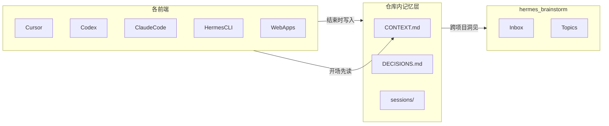

# 跨 App Agent 记忆协议

> 把对话连续性从各 App 的私有 session，下沉到「仓库内可版本化的工作记忆」。
> 不追求全量同步聊天记录；同步的是状态、决策与可交接摘要。

## 问题

同一仓库换 Cursor / Codex / Claude Code / Hermes / 网页版打开时，厂商私有对话全部丢失，只能口头复述。

## 原则

1. **不同步全文 transcript** — 格式封闭、体积大、噪声多；默认只写摘要
2. **记忆跟着仓库走** — 每个工作仓自己的 `CONTEXT.md` / `DECISIONS.md` / `sessions/`
3. **brainstorm 只存协议与跨项目洞见** — 不集中托管各项目半成品上下文
4. **按需落盘** — 会跨 App 继续、或决策已定，才写；闲聊不写

## 三层记忆

| 层 | 路径（工作仓根目录） | 用途 | 何时更新 |
|----|----------------------|------|----------|
| 冷启动 | `CONTEXT.md` | 一页纸当前真相 | 每次会跨 App 继续的会话结束前 |
| 决策 | `DECISIONS.md` | 追加式决策日志 | 有新决策时 |
| 会话 | `sessions/YYYY-MM-DD-<topic>.md` | 单次会话摘要 | 有实质进展时 |
| 长期 | `hermes_brainstorm` inbox → topics | 跨仓库仍有用的洞见 | 值得沉淀时 |

模板副本见本仓库 [`templates/`](../../templates/)。复制到目标工作仓根目录后按需填写。



## 开场 / 收尾话术

### 通用（任意 App 粘贴）

**开场：**

```text
先读本仓库根目录的 CONTEXT.md 与 DECISIONS.md（若存在），再动手。
用其中的目标、阻塞、下一步作为当前任务的起点；不要假设你记得上一次对话。
```

**收尾（有实质进展时）：**

```text
请更新 CONTEXT.md（目标/进度/阻塞/下一步）。
若本次有新决策，追加到 DECISIONS.md。
若值得交接，在 sessions/ 下按模板新建一篇摘要（只写摘要，不要贴全文对话）。
```

### 网页版额外一句

ChatGPT / Gemini / Grok / Minimax / DeepSeek 等无法写盘时，收尾改为：

```text
请按本仓库 templates/session-summary.md 的字段输出一篇 Markdown 摘要，
并给出更新后的 CONTEXT.md 全文，方便我粘贴进仓库。
```

可粘贴的 Cursor Rule / Hermes·Claude skill 见 [`templates/agent-memory-rule.md`](../../templates/agent-memory-rule.md)。

## 按工具落地

| 类别 | 做法 |
|------|------|
| Cursor / Claude Code / Codex | 启用 Rule/Skill：开场读、收尾写；可选再人工提炼进 `sessions/` |
| Hermes CLI | Skill 或 session-end 钩子写回当前工作仓 |
| 网页版 | 模型输出同模板 Markdown → 粘贴进 `sessions/` 并视情况改 `CONTEXT.md` |
| 本地 bot（能访问工作目录） | 同本地 IDE Agent；否则同网页版 |

## 成功标准

换 App 打开同一仓库后，新 Agent 读完 `CONTEXT.md` + 最近 1–2 篇 `sessions/` 摘要，能在约 1 分钟内接上：目标、约束、下一步，无需口头复述整段历史。

## 刻意不做

- 各厂商 chat 历史统一同步器
- 第一版向量库（Markdown + Git + 文件名/标签足够）
- 每次闲聊都落盘

## 相关

- [Prompt → Context → Harness → Loop](../../ideas/inbox/prompt-to-loop-engineering.md) — 本协议属于 Context / Harness 层实践
- 本仓试点：根目录 [`CONTEXT.md`](../../CONTEXT.md)、[`DECISIONS.md`](../../DECISIONS.md)、[`sessions/`](../../sessions/)
